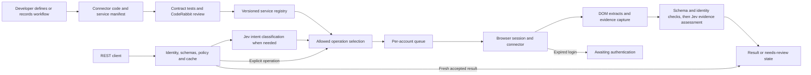

# Gateway: browser automations as services

> Historical discussion. For the current implementation handoff read [product overview](product-overview.md), [spec](spec.md), and [demo](demo.md). These supersede conflicting alternatives below.

> **Recorder reuse, September 26:** The dental submodule already implements a web recorder, sanitized event pipeline, confirmed-flow compiler, and Playwright-backed replay runtime. Adapt that pipeline for Gateway instead of starting with a new recorder. Generated code depends on `RelayBrowserRuntime`; it is not standalone Playwright code. Keep the recorder and reviewed flow contracts; target Jev Ultrafast as the primary execution engine through a new adapter. The existing Playwright replay runtime remains a possible later adapter. See [source review](docs/research/recorder-reuse.md). This refines the earlier proposed capture approach; no code has been extracted.

> **Engine evaluation, September 26:** `browser-use/jev-ultrafast` is recommended as the first hackathon engine adapter, subject to a bounded live feasibility check. It is a Python agent using Browser Harness, not a drop-in Playwright connector. Gateway still owns contracts, account isolation, policy, extraction, and independent acceptance. See [engine evaluation](docs/research/jev-ultrafast.md). This recommendation has not been implemented. The plan below incorporates the developer recorder workflow clarified by the user.

**Date:** 2026-09-26
**Status:** Proposed architecture and hackathon demo plan. No implementation or deployment authorized by this plan.
**User direction:** A gateway framework like LoopBack, for browser automations as services. Developers use a web application to record a browser workflow, parameterize it, test it, and expose each automation as a set of typed endpoints. Delta Dental eligibility and benefits is the first target workflow. Remain in architecture/planning until implementation is requested.
**Appetite:** Three-hour hackathon build window. The recorder-to-endpoint flow is core scope. Restrict recording to one workflow and common controls; advanced recorder features are optional. Reassess the remaining event time before implementation.

## Frame

Developers can automate a portal, but turning a script into a callable service requires input/output contracts, account sessions, queuing, failure states, and evidence. Gateway packages these into a reusable framework.

**Pitch:** Record a browser workflow. Turn it into a typed API. Run it with Jev and get results with evidence.

Success: a developer starts a recording from the web app, demonstrates a workflow, marks inputs and outputs, tests it with different inputs, and publishes a version that exposes callable endpoints and OpenAPI documentation. An API consumer then runs it without driving the browser themselves and receives structured results with evidence or an explicit exception.

Tandem eligibility verification is one potential consumer. The framework itself should use general concepts such as service, operation, account, run, observation, and evidence. Keep payer IDs, 270/271 adapters, and practice-specific policy in a Tandem integration.

## Evidence and interpretation

The two user screenshots show one verification API routing to cached results, direct API adapters, certified browser readers, or manual follow-up. Browser work passes through an account queue, persistent workspace, authentication recovery, and evidence collection. Green annotations place Jev at the router and result boundary and propose a portal recorder plus CodeRabbit CLI review.

The hosted briefing returned a sign-in page; the rest of the deck was not inspected. Screenshot annotations are design inputs, not instructions to execute external actions.

LoopBack provides a useful analogy: schemas, controllers, services, connectors, and reusable framework components. Borrow that developer experience without committing to LoopBack as a dependency. [LoopBack documentation](https://loopback.io/doc/en/lb4/).

## Primary engine: Jev Ultrafast

**Direction clarified September 26:** Make Gateway's recorded automations execute through Jev Ultrafast. This updates the earlier recommendation to begin with deterministic replay. Engine integration is still unimplemented.

The recorder can continue using Playwright to observe a demonstration. Capture and execution are separate responsibilities. Preserve its sanitized events, variable definitions, selectors as authoring evidence, and developer-confirmed outputs/assertions. Compile these into a versioned engine-neutral workflow definition, then produce a Jev execution specification rather than asking Jev to execute generated Playwright source.

```text
Web recorder (Playwright capture)
  → sanitized recording
  → reviewed inputs, outputs, ordered checkpoints, and assertions
  → Gateway workflow definition + generated endpoints
  → Python adapter → Jev Ultrafast → Browser Harness/CDP → Chrome
  → extraction + independent verification → typed result and evidence
```

### Adapter responsibilities

- Translate developer-confirmed workflow intent and validated runtime arguments into a bounded task. Retain ordered checkpoints in Gateway's controller; do not flatten the entire recording into one unverified free-form goal.
- Use observed page state to establish the current checkpoint and whether its postconditions passed. Missing or ambiguous evidence yields an exception; the model's DONE answer cannot advance the workflow by itself.
- Drive the engine through its separate predict/act interface so Gateway can inspect a proposed action before execution. Add explicit policy hooks to the pinned adapter where needed. Model-generated operation/target IDs must continue to resolve only to current observed elements.
- Preserve account/session ownership through a browser injection/connection seam. Upstream Agent currently constructs its own Browser, so connecting to Gateway's controlled browser requires adaptation. Do not let a worker silently attach to a developer's unrelated Chrome profile.
- Handle exact parameter and credential entry through an explicitly identified, validated field binding in the adapter. Upstream generates all typed text with a second model; a Gateway fork can provide deterministic values for confirmed bindings without passing credentials to that model. Unknown bindings pause instead of guessing. This is a deliberate extension of upstream behavior, not an existing feature.
- Use runtime checks and browser-level restrictions for allowed origins and prohibited effects. Prompt instructions alone do not enforce either. A general read-only guarantee for arbitrary websites is not provided by the engine.
- Extract declared output fields and independently compare subject identifiers and completion assertions. Collect authorized evidence before closing the browser tab; publish only the Gateway result envelope, not raw agent state.
- Expose step events, deadlines, cancellation, and normalized failure reasons to the API. Persist the workflow version, pinned engine revision, and actual model version with each run.

The upstream package does not import recordings, interpret Gateway's checkpoint definition, or implement typed business output extraction. Those are the concrete bridge we must build. Its iframe, shadow-root, popup, and other documented interaction limits still apply after wrapping it.

**First integration slice:** Record a synthetic lookup, confirm one input and one output, publish an endpoint, invoke it with a second input, let Jev perform the browser actions, and independently verify that the returned result belongs to that second input. Show a failed checkpoint as an explicit run exception. This proves recording-to-Jev execution without claiming a complete live Delta Dental integration.

## Architecture



### Service contract

Conceptual TypeScript API, not an existing package API:

```ts
defineBrowserService({
  id: 'demo-portal',
  version: '1.0.0',
  origins: ['https://demo-portal.example'],
  accountScope: 'tenant-account',
  operations: {
    lookupStatus: {
      input: LookupInputSchema,
      output: LookupOutputSchema,
      effect: 'read',
      cacheTtlSeconds: 60,
      run: lookupStatus,
      assess: statusEvidenceQuestions,
    },
  },
});
```

`run` receives validated inputs, a browser page, and evidence helpers. It returns candidate values plus references to their captured source. The gateway owns validation, account locking, budgets, status transitions, caching, and acceptance. Connector code must be reviewed and trusted; a JavaScript interface is not a sandbox for arbitrary uploaded code.

Service registration supplies discovery metadata, operation endpoints, and an OpenAPI description. SDK and MCP adapters can consume the same definitions later.

### Jev's roles

0. **Browser execution:** The proposed Jev Ultrafast adapter uses Jev to choose observed actions and targets. Recording supplies reviewed checkpoints, task intent, and examples; the engine does not currently import or replay recordings. A compilation/adapter layer must translate the recorded workflow into a goal and independently verified checkpoints.
1. **Optional semantic routing:** Map a natural-language request to one of the registered, permitted operations or `unsupported`. An explicit operation ID bypasses classification. The caller supplies typed arguments; the MVP does not promise arbitrary argument extraction. Code validates the selected operation and inputs. Jev cannot grant access or choose arbitrary URLs.
2. **Evidence assessment:** Ask narrow questions about captured text: does this page explicitly support the proposed status, does it show conflicting status information, or does it indicate an incomplete result? Compare identifiers, timestamps, required fields, and schema in code first. Return `needs_review` when evidence is missing, contradictory, or uncertain.

The browser supplies facts and extracts values. Jev assesses supplied evidence. It does not create provenance, prove source authenticity, or guarantee truth. Keep question-specific outputs and uncertainty visible instead of inventing a universal reliability score. Choose provisional thresholds with labeled fixtures and disclose their limited validation.

Official Jev docs support Choice, Score, and Noul questions over supplied state and recommend decomposing decisions. [Jev introduction](https://docs.typesafe.ai/introduction).

### Runtime and isolation

Use a Node/TypeScript gateway, a small SQLite run store, an account-scoped FIFO, and a Python worker wrapping a pinned Jev Ultrafast revision. A browser provider interface leaves room for deterministic Playwright execution. Jev Ultrafast currently uses Browser Harness and the existing Chrome profile; account isolation and hosted Browserbase connection support need explicit adapter work. For the hackathon, use a dedicated demo browser profile. These are proposed choices, not implemented capabilities.

Reuse one browser context per tenant, site, and account. Serial execution prevents account session collisions. Browserbase Contexts persist authentication data between sessions but do not guarantee the site keeps the user signed in. Save and restore contexts according to provider lifecycle rules. [Browserbase contexts](https://docs.browserbase.com/platform/browser/core-features/contexts).

For the hackathon, a single worker is sufficient. Persist runs and mark interrupted runs explicitly on restart; do not claim distributed durability or exactly-once execution. Add a deadline and one bounded transient-error retry for reads. Never cache incomplete or review-required results.

Derive tenant identity from the authenticated caller and authorize account access before consulting cache, runs, or evidence. Scope cache keys by tenant, account, service version, operation, and normalized input. Recheck authorization on retrieval. Store session secrets separately from evidence. Demo inputs are synthetic; no live clinical integration is required.

### API and observable states

- `GET /services`: registered operations and schemas.
- `POST /services/:serviceId/:operation/runs`: typed invocation; idempotency key prevents duplicate submissions for the same scoped request, with conflict detection if the body differs.
- `POST /dispatch`: optional intent classification plus supplied typed inputs.
- `GET /runs/:id`: state, decision metadata, and accepted result where available.
- `GET /runs/:id/evidence`: authorized evidence references.

Return HTTP 200 for a valid cache hit. Return 202 plus run ID and status URL for queued work. A successful GET of a run returns 200 even if the run's business state is `needs_review`; HTTP success must not imply an accepted observation.

States: `queued → running → completed | needs_review | awaiting_auth | failed`. `awaiting_auth` resumes only after authentication is restored and checked. MVP may expose the paused state without implementing a full resume UI.

Result envelope: run ID, service/version, operation, observation, observed-at time, source URL, screenshot or extract reference, run trace, Jev model/question version and outputs, cache metadata. Cache hits preserve the original observation time.

## Recorder and CodeRabbit flow

Target experience: record a portal read, parameterize inputs, define extracted outputs, add assertions and Jev questions, review generated code, run contract fixtures, then register a version.

The web app must initiate and receive a real browser recording. Use an existing recorder through a local companion or an explicitly connected controlled browser; the web page alone cannot inspect arbitrary third-party tabs. An extension is an alternative capture adapter, not a second required implementation. Playwright codegen is a possible capture backend, but requires integration with the developer app and does not infer the full service contract. [Playwright codegen](https://playwright.dev/docs/codegen).

The recording artifact contains ordered actions, semantic target descriptions, navigation observations, declared variables, and chosen output/checkpoint definitions. Capture credential inputs as secret references without their values. Keep authentication setup separate from each business operation. The developer reviews inferred steps and schemas before publishing an immutable service version. The recording compiler and engine adapter are distinct: Jev Ultrafast is an executor, not the recorder or endpoint generator.

CodeRabbit CLI reviews connector changes during development. It is outside the runtime request path. Review plus passing fixtures support the label `reviewed connector`; neither establishes certification. If showing a review in the demo, preserve the real review and commit/version association. [CodeRabbit CLI](https://docs.coderabbit.ai/cli/).

Do not claim the CodeRabbit Coding Agent prize based solely on CLI review; the event brief specifies use of the Coding Agent for that award. Sponsor eligibility still needs confirmation.

## Developer studio and generated endpoints

The primary web app flow is **Automations → New automation → Record → Define inputs/outputs → Test → Publish → API explorer**. Show recording state, captured steps, browser connection state, and explicit capture failures. A screenshot alone is not a recording.

One automation is a named business operation, not one endpoint per click. Publishing creates an endpoint set for invoking it and retrieving its status, result, and evidence. Multiple separately defined operations can share the same portal connector and account session.

Proposed example for a published `delta-dental-eligibility` automation:

| Method and path | Purpose |
|---|---|
| `POST /v1/automations/delta-dental-eligibility/runs` | Validate inputs and start an eligibility lookup |
| `GET /v1/automations/delta-dental-eligibility/runs/:runId` | Inspect progress or failure reason |
| `GET /v1/automations/delta-dental-eligibility/runs/:runId/result` | Retrieve the verified structured result when ready |
| `GET /v1/automations/delta-dental-eligibility/runs/:runId/evidence` | Retrieve authorized supporting evidence |
| `GET /v1/automations/delta-dental-eligibility/openapi.json` | Discover schemas and endpoints |

These are proposed public paths, refining the earlier generic service API. Business result reads before completion return an explicit not-ready response, not empty successful data. The internal service registry remains shared across automations. Version the API contract and pin each run to an immutable automation revision; publishing a new revision must not change running work.

### LoopBack concepts mapped to Gateway

| Concept in the supplied diagrams | Gateway counterpart |
|---|---|
| Models | Automation input, output, run, and evidence schemas |
| Controllers / API generation | Routes generated from published operation definitions |
| Services | Reusable browser business operations |
| Connectors / data sources | Portal adapter plus browser/account connection |
| Repositories | Stored definitions, versions, runs, and evidence metadata |
| Core and tooling | Execution lifecycle, policies, recorder, test runner, API explorer |

This mapping uses the supplied diagrams as architectural reference; it does not imply browser automation should expose every possible CRUD action on a portal.

## First target: Delta Dental eligibility and benefits

**Observed:** A username-first sign-in screen, and later an authenticated Eligibility & benefits Overview page. The latter contains member/plan identification, eligibility dates, benefit categories by network, maximums, deductibles, and benefit package history. Tabs exist for Plan provisions, Waiting periods, Benefits search, Treatment history, and Family members. Download/print summary controls are visible.

**Not observed:** The intervening password/MFA sequence, patient search method, record-selection steps, the contents of the other tabs, and summary download behavior. Do not infer recorded actions from endpoint screenshots. Finish that walkthrough before treating the connector as specified.

**Proposed first operation:** `getEligibilityOverview`. Inputs include an authorized account/location reference and the search fields actually demonstrated (still to confirm). Outputs contain eligibility and plan data, network-specific benefit categories, maximum/deductible rows with their periods and applicable treatments, portal as-of date, and evidence. Preserve row relationships and the portal's qualification that the display is not a guarantee of eligibility, benefits, or payment.

Plan provisions, waiting periods, procedure-code benefits, and treatment history can become additional named operations after their workflows are recorded. They are not assumed supported by the first recording. Authentication is a reusable account prerequisite, with awaiting-auth on expiry.

Only workflow structure is recorded in this note. No patient identifiers or patient-specific benefit values are included. Public demo fixtures should use synthetic records.

## Hackathon scope

**Must ship:** Developer web page with a real Start/Stop recording flow; recorded-step review; input and output definition; one test run; publish a version; generated invocation/status/result/evidence endpoints and OpenAPI; one real browser execution path with Jev; typed extraction and independent verification; explicit exceptions; compact run inspector. Use a controlled synthetic eligibility portal for the public demonstration. The real Delta Dental workflow is the target integration, not a claim of completed support.

**Stretch:** Natural-language dispatch; second automation; rich recorder editing; visible authentication resume; caching beyond the core run flow. A second recorded automation is the strongest proof that endpoint creation is reusable.

**Deferred:** General-purpose recorder supporting all browser features, automatic connector repair, production portal certification, E2B orchestration, automated SMS/email/TOTP brokerage, payer APIs, multi-region workers, webhook delivery, MCP server, billing, and marketplace. Browserbase and E2B are alternative execution adapters initially, not two required layers.

## Three-hour delivery plan

| Minutes | Integrated outcome |
|---|---|
| 0–20 | Prove browser recording capture and Jev execution separately; settle one synthetic workflow |
| 20–65 | Web app starts/stops recording; shows captured steps; developer marks one input and output contract |
| 65–105 | Compile reviewed definition; publish version; generate endpoint/schema; queue and run the Python engine |
| 105–135 | Extract output, verify identity and evidence, expose result and explicit failure states |
| 135–155 | Test with different input; reject incomplete output; review code and fix material issues |
| 155–180 | Rehearse recording-to-API demonstration, capture backup, document limits and submit |

If time slips, cut semantic dispatch, second automation, cache optimization, and recorder polish. Preserve actual recording, parameterization, endpoint publication, browser execution, and verification. If the capture-to-execution bridge cannot be proven early, revisit the appetite explicitly rather than replacing recording with a simulated button. If Jev access fails, disclose the limitation; do not present a stub as live inference.

## Demo narrative: about three minutes

1. **Problem, 20 seconds:** Browser scripts are hard to consume as services because callers also inherit session, failure, and verification logic.
2. **Developer experience, 30 seconds:** Start a recording from the web page, demonstrate the short workflow, mark its variable input/output, and publish its endpoint/schema. Use a prepared recording if live recording exceeds the demo slot, clearly labeling it.
3. **Execution, 50 seconds:** Invoke an operation. Watch a real portal run; show structured data alongside its source evidence and Jev assessment.
4. **Meaningful failure, 35 seconds:** Change the synthetic portal to a contradictory or incomplete result. The same API returns needs-review rather than accepted data.
5. **Reuse, 25 seconds:** Invoke the same generated endpoint with a different synthetic member input and show a different, correctly matched result.
6. **Close, 20 seconds:** Tandem is the motivating application. Gateway makes the service contract, account execution, and evidence checks reusable across portals.

The decisive moment is the evidence failure being caught while the service contract stays stable.

## Acceptance criteria

- The developer web app captures an actual browser demonstration and displays its steps.
- Recorded input values can become typed parameters; a changed input works without editing framework code.
- Publishing a tested definition creates versioned endpoints and an OpenAPI contract.
- Credential values and live patient data are absent from committed definitions and public demo fixtures.

- Valid API invocation triggers an actual browser operation and actual Jev call, with traceable outputs.
- Invalid inputs fail before browser launch.
- Accepted data matches captured fixture values and includes timestamped evidence.
- Missing fields, identity mismatch, conflicting evidence, and Jev unavailability cannot yield a completed accepted observation.
- Fresh cache returns the original observation without browser execution; stale or differently scoped requests miss.
- Same-account operations serialize; another tenant cannot access run, cache, or evidence records.
- An expired login or changed selector yields an explicit state rather than a fabricated result.
- The demo reports observed latency and fixture outcomes, without claiming production reliability from a small sample.

## Open decisions for implementation

Confirm available API credentials without printing them, choose local versus hosted browser runtime based on access, verify existing-code eligibility with organizers, and determine whether the remaining event time supports the full appetite. No application code, hosted site, external account, or production Tandem document was changed during this planning pass.
