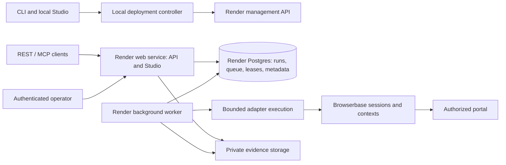

# V1 environments, configuration and deployment

This is an environment contract on paper, not deployable configuration. All `PIXIE_*` names below are proposed
application configuration, not existing code. Provider mapping and exact runtime versions must be pinned before
implementation. No real secrets or provisioned resource IDs are included.

## Environment inventory

| Environment | Purpose | Services / browser / data | Promotion rule |
|---|---|---|---|
| Local fixture | Developer authoring and deterministic safety tests | CLI + Studio/API + worker + local Postgres; local Chromium; disposable Todo fixture | No cloud keys required for scripted tests; agent key only for authoring/repair. |
| Local + cloud browser | First Lemonade E2E before hosting API | Local runtime/database, Browserbase session and per-user context | User logs in through Browserbase; synthetic fixtures need a cloud-reachable host. |
| CI | Build, type/lint, unit/contract tests and fixture CRUD | Ephemeral Postgres/Chromium/fixture; model calls disabled | No production credentials; trusted manually gated job for paid provider integration. |
| Preview | Optional UI review | Build/static concept or isolated app + synthetic data | No production sessions; not required infrastructure for every PR. |
| Staging | Provider, persistence, recovery and hosted smoke qualification | Render API/Studio + worker + Postgres; dedicated Browserbase project/context; hosted synthetic portal | All release gates pass on pinned artifact; real account only by explicit authorization. |
| Production / operator install | Published APIs in operator's accounts | Separate Render services/Postgres and Browserbase project/keys; account-scoped contexts | Verified artifact + configured connection + hosted smoke checks before activation. |

Never reuse production contexts, portal credentials, database dumps or control URLs in CI/preview. A new install
needs a funded Render account/workspace, Browserbase account/project, supported model-provider access for authoring,
and hosted identity configuration. Operators own resources and charges. Cost/SKU review happens before first create.

## Proposed deployment topology

Proposed baseline: two processes/services plus Postgres; durable queue in Postgres, not in-memory. Use immutable
bundles delivered through a pinned build artifact or Git revision; exact artifact transport is a feasibility decision.
Small sanitized JSON evidence can live in Postgres; bulk screenshots/downloads are disabled by default. Enabling
bulk capture requires private object storage and explicit retention/access setup. The database is not a cookie vault.

The deployment controller owns Render credentials locally; ordinary hosted workers do not receive the Render key.
Hosted application receives only runtime configuration. Redeploying runtime and activating an operation revision
are distinct: service deploy success alone is not operation acceptance.

## Prerequisites and build inputs

- Git, pinned supported Node.js LTS/package manager, locked dependencies, TypeScript/React build tools and supported
  Chromium/Playwright candidate runtime. Exact versions follow the compatibility spike, not an untested guess.
- Local Postgres or container equivalent, migrations and synthetic portal fixture; reproducible clean bootstrap.
- Ultrafast-compatible authoring runtime and model provider configuration; generator identity/version recorded.
- Browserbase SDK/CDP compatibility, live-view ownership behavior and context synchronization demonstrated.
- Render workspace/resource permission, service region/plan, persistent Postgres, HTTPS hostname and OIDC client.
- Build artifacts contain no keys; migrations are versioned, backwards compatible for rollout, and tested on staging.

## Configuration inventory

| Proposed variable / setting | Used by | Secret? | Required when / purpose |
|---|---|---|---|
| `NODE_ENV` | API/worker/build | No | Development/test/production mode. |
| `PORT` | Web service | No | Supplied hosting port; bind hosted interface, loopback in local mode. |
| `DATABASE_URL` | API/worker/migrations | Yes | Internal Postgres connection; separate per environment. |
| `PIXIE_ENVIRONMENT` | All | No | local/test/staging/production label and namespace. |
| `PIXIE_PUBLIC_URL` | API/Studio | No | Canonical HTTPS origin; loopback URL locally. |
| `PIXIE_ALLOWED_ORIGINS` | API | No | Explicit CORS/origin policy; no wildcard credentialed access. |
| `PIXIE_AUTH_MODE` | API | No | local-token or hosted OIDC; no production auth-off mode. |
| `PIXIE_OIDC_ISSUER`, `PIXIE_OIDC_CLIENT_ID` | API | No | Hosted identity provider and client. |
| `PIXIE_OIDC_CLIENT_SECRET` | API | Yes | Hosted OIDC confidential client credential. |
| `PIXIE_SESSION_SIGNING_KEY` | API | Yes | Secure application session signing and rotation. |
| `PIXIE_ENCRYPTION_KEY` | API/worker | Yes | App-managed sensitive data encryption; key version and rotation procedure required. |
| `BROWSERBASE_API_KEY` | Browser session controller/worker | Yes | User-provided provider credential, never sent to frontend. |
| `BROWSERBASE_PROJECT_ID` | Session controller | No | Explicit project even if provider permits inference. |
| `PIXIE_BROWSER_PROVIDER` | Runtime | No | local or browserbase; validated per target. |
| `PIXIE_BROWSER_REGION` | Session controller | No | Explicit provider-supported region chosen at setup. |
| `RENDER_API_KEY` | Local deploy controller only | Yes | User-provided Render management credential. |
| `PIXIE_RENDER_OWNER_ID` | Deploy controller | No | Selected owner/workspace target. |
| `PIXIE_RENDER_REGION`, `PIXIE_RENDER_SERVICE_PLAN`, `PIXIE_RENDER_DB_PLAN` | Deploy controller | No | Resource selections reviewed before provisioning. |
| `PIXIE_MODEL_PROVIDER`, `PIXIE_AUTHORING_MODEL` | Authoring/repair only | No | Selected supported provider/model; recorded with generated revision. |
| `PIXIE_MODEL_API_KEY` | Authoring/repair only | Yes | Proposed abstraction mapped to selected provider SDK; ordinary runner receives none. |
| `PIXIE_RUN_TIMEOUT_SECONDS` | Worker | No | Proposed default 300 active-execution seconds, configurable within provider limits. |
| `PIXIE_HANDOFF_TIMEOUT_SECONDS` | Runtime | No | Proposed default 600 seconds waiting for user. |
| `PIXIE_SESSION_MAX_SECONDS` | Session controller | No | Proposed default 1200 total seconds; preflight checks plan/provider limit. |
| `PIXIE_MAX_CONCURRENT_RUNS` | Scheduler | No | Proposed default 2/install, plus mandatory 1/context writer. |
| `PIXIE_MAX_QUEUE_DEPTH` | API/scheduler | No | Proposed default 100; explicit rejection at capacity. |
| `PIXIE_LEASE_SECONDS`, `PIXIE_HEARTBEAT_SECONDS` | Worker/scheduler | No | Proposed 60/15; fencing generation guards expired workers. |
| `PIXIE_LOG_LEVEL` | Services | No | Structured operational logs, no input/page/secret dumps. |
| `PIXIE_RESULT_RETENTION_DAYS`, `PIXIE_EVENT_RETENTION_DAYS` | Cleanup | No | Proposed 7 days sensitive results, 30 days sanitized events; operator-configurable. |
| `PIXIE_CAPTURE_ENABLED` | Session controller | No | Default false for authenticated sessions; explicit consent/configuration for capture. |
| `PIXIE_EVIDENCE_BUCKET`, `PIXIE_EVIDENCE_REGION`, `PIXIE_EVIDENCE_ACCESS_KEY`, `PIXIE_EVIDENCE_SECRET_KEY` | Evidence service | Last two yes | Conditional only if private bulk evidence enabled; provider chosen before enablement. |

Connection context IDs, expected account identity, allowed domains, operation limits, deployment resource IDs,
caller-token hashes and active revision bindings belong in scoped records, not one global environment variable.
Portal passwords/OTPs are entered by the human in the browser; no `LEMONADE_PASSWORD` or `MFA_CODE` configuration.
Caller API tokens are separately issued, hashed, scoped and revocable; they are not Browserbase or Render keys.

Timeout values are proposed defaults to validate, not measured service guarantees. Human wait counts toward total
session lifetime but not active execution budget. Deadline precedence is the earliest applicable limit. A cleanup
reconciler must release provider sessions even if the worker crashes.

## Publish and operations contract

1. Verify local tests/artifact hashes, credentials/permissions, chosen resource plans and connection readiness.
2. First-time setup displays resource ownership and cost inputs; later publishes reuse resources.
3. Build immutable artifact, run migrations safely, create/update runtime using idempotent provider reconciliation.
4. Deploy candidate, check readiness, execute authorized hosted smoke test; pause for authentication when necessary.
5. Atomically activate operation bindings only after success. Retain old bindings on failure.
6. Expose URLs for authenticated OpenAPI, REST, MCP and Studio; demonstrate operation after local shutdown.

Health: liveness checks process; readiness checks database/migration compatibility and queue access. Browserbase
outages degrade execution readiness/status without hiding historical results. Track queue age, failures, verification
failures, handoff durations, context reuse, orphan sessions, latency and measured provider/model usage by phase.
No invented cost or latency claims. Export sanitized operational logs; alerts identify failures without portal data.

Back up internal Postgres before migrations and on a documented production schedule. Rehearse restore in staging,
including fencing old workers and reconciling provider sessions. Rotation covers provider keys, caller tokens, OIDC
and signing/encryption keys. Disconnect revokes context access, drains/stops affected runs and deletes provider
context when requested; deletion failures remain visible and retryable. Teardown inventories resources and preserves
only explicitly requested audit/export data. Code rollback does not restore a database or undo portal changes.

## Verified provider references

Reviewed 2026-10-21; recheck SDK/plan support during implementation.
- [Browserbase Contexts](https://docs.browserbase.com/platform/browser/core-features/contexts): context reuse, persistence on close and site-driven auth expiry.
- [Create Session](https://docs.browserbase.com/reference/api/create-a-session): session settings/timeouts; keep-alive is plan-dependent.
- [Render Blueprint specification](https://render.com/docs/blueprint-spec): service/database/environment configuration and validation.

These references establish provider primitives; they do not prove Pixie's sandbox, handoff, deployment or portal compatibility.
