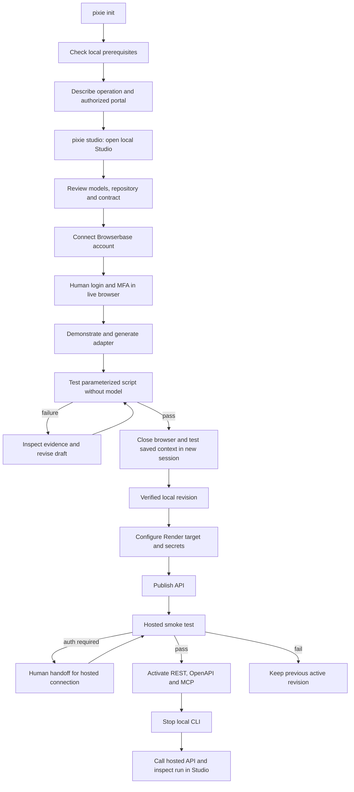

# V1 experience — CLI → Studio → published API

Review resolution: [decisions and bounded G1 authorization](v1-review-decisions.md) supersede conflicting earlier wording. Cloud and real-portal gates remain closed.

The demo site's structure is the interaction reference. The actual app must replace every simulated event with
recorded state. Commands below define proposed UX; no working CLI is claimed and syntax may change after review.

## End-to-end user flow



## CLI contract

| Proposed action | User experience / output |
|---|---|
| `pixie init <name>` | Create manifest and model/repository/adapter/test directories, no paid resources; refuse unintended overwrite. |
| `pixie doctor` | Check runtime, browser, database and configured provider readiness; secret values redacted. |
| `pixie author <operation>` | Capture intent, allowed effects/domains and inputs; review draft; agent activity visibly labeled. |
| `pixie studio` | Start loopback Studio/API and open authenticated local link; print recovery URL without persistent secret logging. |
| `pixie test <operation>` | Execute pinned draft/tests, print run URL, checks and exit code; model access disabled for ordinary execution. |
| `pixie providers configure` | Secure provider setup, ownership target, resource review; no echoed keys. |
| `pixie publish` | Same gates as Studio Publish; return deployment/run status, never bypass failed tests. |
| `pixie status` | Current project, revisions, connections and active deployment without secrets. |

Noninteractive execution fails with actionable missing-input errors. Human-required runs print a protected Studio
URL and durable run ID. CLI exit does not cancel hosted work; explicit Stop does. Local worker shutdown records
interruption, releases sessions, and never claims hosted durability for local-only work.

## Studio navigation and screen specification

Global shell: project/environment switcher, local/hosted indicator, connection health, active revision, user menu.
Primary navigation mirrors the demo: Overview, Architecture, Contract, Connection, Test, Runs, API, Repair, Publish.
Provider/security settings are operator-only. Switching environments must visibly switch both runs and connections.

| Screen | Contents and primary actions | Empty/error/loading behavior |
|---|---|---|
| Overview | Workflow description, readiness checklist, last tests, active deployment; continue next incomplete step. | New project offers author/connect; provider outage shown independently of test status. |
| Architecture | Select model → operation → repository → adapter; inspect schema/source and version relationships. | Unimplemented methods labeled unavailable, database connectors labeled next phase. |
| Contract | Input/output schema, sample input, allowed effects, verification, pagination and limits; edit draft and validate. | Validation errors at fields; published contract read-only with create-new-version action. |
| Connection | Account alias, environment, provider, auth health, last verified; Connect, Reauthenticate, Disconnect. | Never show cookies/keys; revoked connection blocks new runs and explains recovery. |
| Test | Input editor, suite selection, Run/Stop; browser left, results right, execution flow below. | Until verified show pending/unverified; disconnected live browser retains run state with reconnect action. |
| Runs | Filter by operation/status/connection/revision/date; run detail, timestamps, events and checks. | Empty list offers first test; stale status marked reconnecting, not silently frozen as live. |
| API | Supported endpoints/MCP tools, schemas, authenticated explorer, curl sample, result/run links. | Unpublished revision shows local-only; no unsupported CRUD controls; errors preserve entered input. |
| Repair | Failure classification, base/candidate diff, frozen-suite evidence, approve/reject and history. | Auth failures route to Connection; failed regression disables promotion. |
| Publish | Target, provider setup, bundle versions, preflight and progress; Publish, retry, rollback. | Failed tests disable Publish; hosted failure preserves old active version; first failure shows unpublished. |

### Test and run layout

At desktop widths: browser session and results are side by side; Jev execution flow spans the row below. Small
screens stack browser, results, then flow with accessible zoom. Do not shrink text to fit an unreadable graph.
Browser pane shows domain, account alias, session state and Watch / Take control / Resume / Stop. Results pane
shows inputs, verification checks, typed output and timestamps. Raw output is visibly unverified until accepted.

Flow nodes: API input → validation/queue → observation → decision (only if called) → policy check → action →
verification → accepted. Loop edges represent recorded events. Failure/handoff/review branches remain visible.
Deterministic execution shows script steps and zero model calls; never animate invented Jev decisions. Selecting
a node opens its sanitized recorded event, timing and verification information. Replay is labeled recorded history;
live view is labeled live. Replay pause/step/speed affects visualization only, never the actual run.

### Human handoff flow

```mermaid
sequenceDiagram
  participant U as User
  participant S as Studio
  participant R as Pixie runtime
  participant B as Browserbase
  R->>B: Start browser with scoped context
  B-->>R: Login required
  R->>R: Persist awaiting_user and deadline
  R-->>S: Protected handoff available
  U->>S: Take control
  S->>R: Request exclusive ownership
  R->>R: Fence automation; settle dispatched actions
  R-->>S: Acknowledge human ownership
  U->>B: Complete login and MFA through live view
  U->>S: Resume
  S->>R: Resume with current generation
  R->>R: Revoke old access; verify account/checkpoint
  R->>B: Continue allowed script
  R->>R: Verify result and persist acceptance
  R->>B: Release browser and persist context
```

Take control/Resume double-clicks are idempotent. A second viewer sees who owns control but cannot drive. Expired
handoff offers a new authorized attempt, never a stale resume. Stop confirms whether dispatch has ceased and
whether a business outcome remains unknown.

### UX quality

Use Pixie's dark neutral surfaces, lime primary accent, readable typography and monospaced identifiers. Status
must use text/icons as well as color. Keyboard access, labeled fields, visible focus, reduced motion and usable
mobile stacking are required. Loading, offline, empty, forbidden and retry states are designed for every screen.
Confirm destructive connection deletion/rollback with explicit effects; do not ask on every reversible action.
Never display real credentials in the demo; fake publication remains clearly labeled in the concept site.
