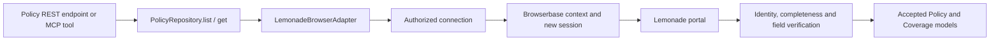

# First end-to-end automation — Lemonade

Review resolution: [decisions and bounded G1 authorization](v1-review-decisions.md) supersede conflicting earlier wording. Cloud and real-portal gates remain closed.

## Objective and evidence boundary

Prove that a developer can author a portal integration locally, log in once through a Browserbase browser,
obtain verified policy data, reuse saved authentication in a distinct session, and publish the same operation to
Render through Studio. Delivery follows the existing CLI → Studio demo flow.

User-provided screenshots establish the intended journey: email login → SMS MFA → account dashboard → policy
list → policy details/coverage controls; a separate life quote wizard gathers information. They do not prove
saved-session compatibility, machine-readable identity, complete pagination, quote persistence or full CRUD.
Screenshots and their personal data/OTP must not be copied into source, docs, demo fixtures or external handoffs.

## Domain contract proposal

| Model | Proposed fields | Verification rule |
|---|---|---|
| Policy | sourceId, type, status, insuredAddress (restricted), coverages, observedAt | Source-backed stable identity scoped to connection; verify selected policy and authenticated account. |
| Coverage | type, limitAmount, currency, deductible when present | Parse visible units; absent/unknown remains null or omitted by schema, never assumed zero. |
| QuoteDraft | sourceId, productType, status, inputs, quotedTerms when available, observedAt | Only if portal has durable retrievable drafts and source identity. Do not invent IDs for nonexistent drafts. |

Real portal data remains protected in runtime/results. Public examples use fictional account aliases and synthetic
values. Models should exclude health/background answers from generic logs; no model fills in unknown personal answers.

## Endpoint capability matrix

All routes are proposed. Domain routes follow the asynchronous run protocol in the main specification.

| Operation | Intended route / repository | V1 commitment |
|---|---|---|
| List policies | `GET /policies` / `PolicyRepository.list` | Required real-portal gate, subject to authorized validation. |
| Read policy | `GET /policies/{id}` / `PolicyRepository.get` | Required; return verified policy/coverage data. |
| Create quote draft | `POST /quotes` / `QuoteRepository.create` | Conditional on a validated draft-only operation and explicit scope decision. |
| Read quote draft | `GET /quotes/{id}` / `QuoteRepository.get` | Conditional on portal-supported reopen/persistence. |
| Update quote draft | `PATCH /quotes/{id}` / `QuoteRepository.update` | Conditional on stable target, supported fields and verifiable result. |
| Delete quote draft | `DELETE /quotes/{id}` / `QuoteRepository.delete` | Conditional on actual discard capability. No fake delete of local metadata advertised as portal deletion. |
| Change active coverage / address | Explicit business command if later approved | Not a launch requirement; needs separate intent, consequence and verification design. |
| Purchase/cancel policy or submit claim | No v1 route | Excluded; not inferred from a CRUD model. |

Controlled Todo create/read/update/delete is mandatory engineering coverage. Lemonade CRUD is not promised by
analogy. If draft operations fail feasibility or lack user-approved scope, ship only supported read methods and
state that limitation in docs, UI, OpenAPI and MCP. Resolve this before freezing the launch feature list.

## Exact demo script and acceptance

1. **Initialize:** developer creates project from CLI, describes list/read policies, opens Studio. Studio displays
   draft Policy/Coverage models, repository methods, adapter and explicit read-only effects.
2. **Connect:** choose Browserbase, create account-bound connection, begin live session. User logs in and completes
   MFA inside that session. No Chrome-cookie import or OTP storage. Verify account identity before proceeding.
3. **Author:** agent explores allowed read path and generator produces parameterized script. Review source,
   contract and independent checks; no policy edits or quote submissions during discovery.
4. **Test:** local runtime executes through Browserbase without model calls. Browser left, result/checks right,
   recorded execution flow below. Verify account, every listed policy identity, selected detail and coverage fields.
5. **Persist:** close the first session with context persistence and allow sync. Start a different session ID with
   the same authorized context. Confirm the account is still authenticated and reads pass. Record both session IDs
   privately as evidence, not raw control URLs. If re-login is required, report it rather than claiming reuse passed.
6. **Publish:** configure user-owned Render target, review first-time resources, click Publish API, run hosted
   read-only smoke test. Cloud connection must be explicitly authorized/configured; never implicitly migrate local
   metadata/credentials. Same Browserbase context can be used only with matching environment/account authorization
   and exclusive ownership; staging/production normally use separate contexts and may need separate login.
7. **Prove hosted independence:** stop local CLI/runtime, invoke authenticated REST then MCP from the documented
   supported client. Return run handle, accepted typed results and evidence in hosted Studio.
8. **Auth recovery:** safely exercise expired auth in the synthetic fixture first; on authorized real account,
   reauthentication is human-controlled. Verify awaiting_user → takeover → resume and no cross-account output.
9. **Maintenance:** induce layout change in a controlled fixture, show failure, reviewed repair and unchanged
   contract. Do not claim we can intentionally alter Lemonade or that a fixture repair proves all portal changes.

## Failure and correctness cases

- Wrong account or missing stable identity: stop before returning data; connection needs correction.
- No policies: accepted empty list only after verified signed-in empty state, not a loading/error screen.
- Multiple policies/duplicate labels: select exact source identity, never first matching address/title.
- Pagination or lazy loading: meet contract completeness; incomplete reads fail or require review explicitly.
- Login redirects across portal subdomains: validate allowed destinations and actual auth behavior; no assumption
  that cookies or authentication on one subdomain cover all others.
- Provider disconnect, portal outage, blocked automation: bounded failure with next action; no bypass claim.
- Human modifies page during takeover: re-observe before continuing; no stale element/checkpoint replay.
- Quote timeout after submission (if enabled): reconcile source outcome or needs_review, never create again blindly.
- Provider context revoked/disconnected: new invocation cannot use it; stale handoff cannot drive browser.

## Definition of done

A recorded, reproducible CLI → Studio → Render demo passes the read contract on the authorized portal; two distinct
sessions demonstrate context reuse; hosted execution works with local runtime stopped; REST and MCP share the
same contract and accepted model; failure/auth recovery evidence is retained privately and sanitized for sharing.
All conditional operations are either independently qualified and approved or absent from the published API.
No actual account changes are authorized by this specification.
