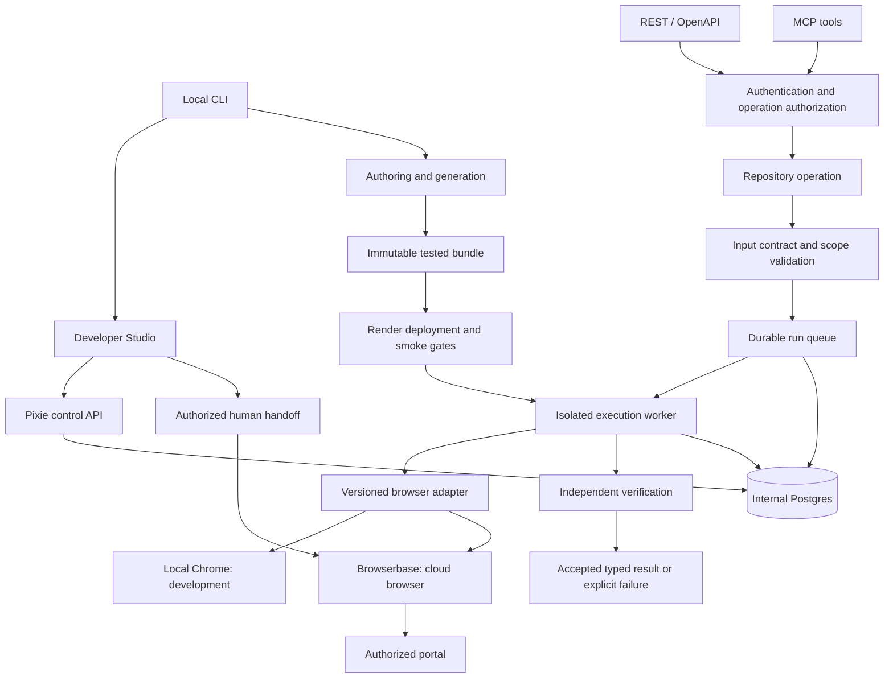
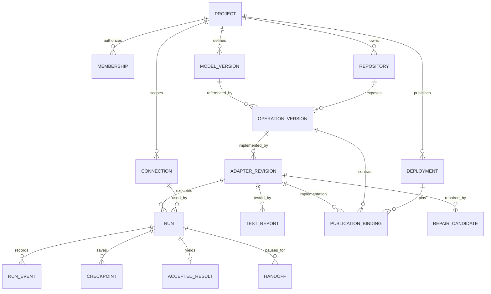
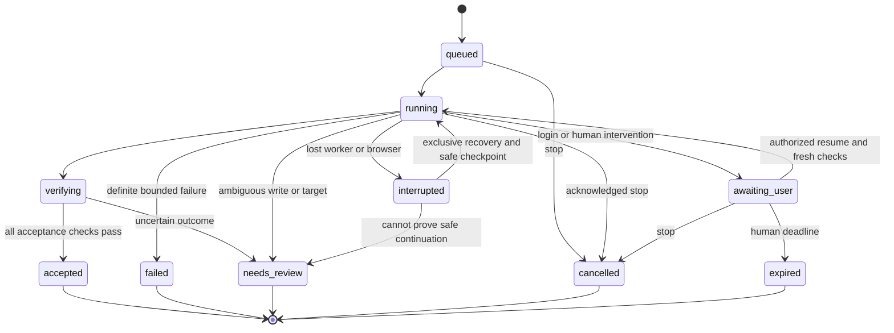

# V1 product specification

Review resolution: [decisions and bounded G1 authorization](v1-review-decisions.md) supersede conflicting earlier wording. Cloud and real-portal gates remain closed.

Status: proposed application behavior. All requirements below are release requirements, not claims about current code.

## 1. Product promise

A developer describes and demonstrates an authorized browser workflow. Pixie turns it into a reviewed,
parameterized script with a typed contract, verifies it, and publishes an API. When authentication expires,
a human unblocks the run. When the website changes, Pixie proposes a tested repair for human review.

The first complete customer journey is CLI → Studio → authenticated Lemonade policy read → repeated run using
saved Browserbase context → Render publication → hosted invocation with the local CLI stopped.

Primary persona: an integration developer who owns deployment and authorizes access to a portal account.
Secondary persona: an authorized account operator who completes login/MFA and reviews uncertain outcomes.
V1 is an operator-owned installation with project-scoped users/tokens, not a hosted SaaS billing product.

## 2. Feature requirements

| ID | Feature | Required behavior |
|---|---|---|
| F01 | Project setup | CLI initializes manifest and draft artifact structure, checks prerequisites, opens Studio. No resources created implicitly. |
| F02 | Models | Review versioned schemas, required/nullable fields, stable account-scoped identity and examples. |
| F03 | Contracts | Declare inputs, outputs, effects, allowed domains, connection, pagination, verification and limits. |
| F04 | Repositories | Expose explicitly supported business methods; unsupported CRUD absent from all transports. |
| F05 | Browser adapters | Generated, inspectable scripts separate from browser provider and API handlers. |
| F06 | Authoring | Ultrafast assists exploration; generator emits bounded parameterized scripts. Exact generator integration is a feasibility gate. |
| F07 | Connections | First login, account validation, context reuse, expiry detection, disconnect and revocation. |
| F08 | Human control | Watch, exclusive Take control, Resume and Stop with durable state and safe ownership transfer. |
| F09 | Test | Input editor, browser alongside results, Jev flow below; assertions, negative tests and evidence. |
| F10 | Runs | Search/filter history, statuses, revision, timestamps, checkpoints, sanitized events and accepted results. |
| F11 | API | Authenticated REST/OpenAPI explorer and MCP bindings generated from the same operation contract. |
| F12 | Publication | Preflight, immutable bundle, Render deployment, hosted smoke check, activation or failure without replacing active revision. |
| F13 | Repair | Classify failure, propose diff, rerun frozen checks, approve promotion and rollback. |
| F14 | Access | Server-side project/connection authorization, scoped caller tokens, restricted handoff and secret management. |
| F15 | Operations | Deadlines, cleanup, durable ownership, restart recovery, retention, health and observable costs. |

## 3. Architecture and responsibility

Render runs API/Studio and execution worker processes. Postgres is the proposed internal run-state and queue store
for v1, reducing infrastructure count; leasing/fencing behavior must pass recovery tests. It is not a domain-data
connector. Browserbase supplies browser infrastructure, not durable Pixie run orchestration.
Generated code runs separately from the API process with bounded CPU/memory/time and scoped secrets/network.
The sandbox mechanism is a blocking technical decision; running generated code in the controller process is unacceptable.

Models define shape and identity. Contracts add semantics and checks. Repositories provide typed operations.
Adapters implement operations with browser scripts. Local Chrome and Browserbase are providers, not repositories.
Commands that are not CRUD can be explicit service operations. No automatic arbitrary filters, joins or transactions.

## 4. Data model

| Record | Minimum fields and invariants |
|---|---|
| Project/membership | ID, role, allowed connections/operations; server-side authorization on every resource. |
| Model version | Name, version, schema/hash, identity fields; immutable once published. |
| Operation version | Repository method, input/output schema refs, effects, checks, domain allowlist, connection requirements, limits, hash. |
| Adapter revision | Source/hash, generator/runtime/dependency versions, compatible contract and model versions. |
| Connection | Project/account binding, provider/project/context references, expected account identity, auth status, last check; no raw cookies. |
| Run | ID, scope, pinned versions, input reference/hash, status, deadline, lease owner/generation, idempotency key, result/error. |
| Checkpoint | Step, before/after evidence refs, intended effect, observed outcome, reconciliation state. |
| Handoff | Run, reason, authorized owner, generation, expiry, acknowledgment; never a permanent public control URL. |
| Test report | Artifact and suite hashes, every attempt, assertions, model calls, timings, costs when measurable. |
| Deployment/binding | Target, provider resource refs, bundle hash, operation/version map, smoke result, activation and prior revision. |
| Repair candidate | Failure, base revision, diff, frozen-suite report, approval identity/time, compatibility decision. |

Domain data (Policy, Coverage, QuoteDraft, Todo) are operation results, not automatically persisted business databases.
Use structured decimal monetary values with currency; never infer missing coverage as zero. Preserve unknown/null
and source observation time. Results declare completeness rather than silently returning a partial list as complete.

## 5. Run lifecycle and protocol

Terminal records are immutable history; a new attempt links to the old run. `needs_review` must not be displayed as
success. Stop prevents further actions after acknowledgment; already dispatched external effects may have occurred.

A request returns `202` with run ID and authenticated status URL. `GET /runs/{id}` returns status, pinned versions,
verification summary, accepted result when available, and a Pixie handoff-page link when authorized. Polling is v1;
webhooks are deferred. Do not keep an HTTP connection open for human MFA. SSE may stream Studio events, but polling
must recover after disconnect. Control commands have operation IDs/generations so duplicate requests are harmless.

Input rejection is 400/422; unauthenticated 401; forbidden 403; missing scoped resource 404; conflicting idempotency
payload 409; rate/queue limit 429. Provider failure never masquerades as an empty successful business result.
Errors include stable code, retryability, run ID and safe next action, with no credentials/page dumps.

For writes, deduplicate by project + operation + connection + idempotency key and payload hash. Persist intent before
the action. A timeout after dispatch requires outcome reconciliation or review, never automatic replay. Reads may
retry only within declared bounds. Approval applies to a specific intent, not unlimited future mutations.

## 6. Auth, persistence and control

One Browserbase context per authorized portal login and environment; one writer at a time. First login occurs
inside Browserbase with persistence enabled; close and allow synchronization before proving reuse in a distinct
session. Saved context, live browser and run record are three different lifetimes. Local Chrome state is never
silently uploaded. Account identity is checked before returning data or applying an action.

Take control fences automation, waits for in-flight actions to settle, then grants one human control. Resume
revokes old control access, verifies ownership, re-observes page/account and reconciles the checkpoint. If provider
access cannot be revoked safely, end that session and establish a safe replacement. UI overlays are not enforcement.
No automatic OTP retrieval. Session expiry invokes authentication handoff, not agent repair.

Operator role can configure/publish/approve repairs; account operator can connect and unblock assigned accounts;
caller tokens invoke allowed operations on allowed connections. No anonymous API explorer or handoff access.
Local Studio binds loopback and requires a generated local token; hosted Studio uses configured OIDC login.
MCP initially targets a documented client capable of configured bearer authentication; client/OAuth compatibility
must be validated and other clients are not claimed supported by default.

## 7. Verification, repair and release

Every execution checks source identity, target uniqueness, output schema, completeness and operation-specific
postconditions. A model's completion statement is not verification. Tests pin independent checks outside the repair
agent's writable scope. Ordinary execution/handoff requires zero attempted model calls.

Classify auth, provider outage, layout drift, ambiguous data and business-rule changes separately. Only compatible
layout/navigation repair can preserve the contract. Show diff and regression evidence before human promotion.
Changing business meaning requires a new contract version. Rollback switches code; it does not reverse portal writes.

Published bundle pins models, contract, adapter, checks, runtime and dependencies. Failed smoke tests leave the active
binding unchanged. First publication failure means no active API. Repeated publication reconciles provider resources
and does not create duplicate services. See environment and acceptance documents for operational gates.

## 8. Explicit non-goals

GraphQL; user database connectors; domain-data synchronization; external API adapters; general ORM/auto-CRUD;
multiplayer editing; automated MFA; autonomous repair promotion; arbitrary ongoing semantic judgment during normal
execution; SaaS billing; insurance purchase/cancellation; claims submission; automatic retries of uncertain writes.
